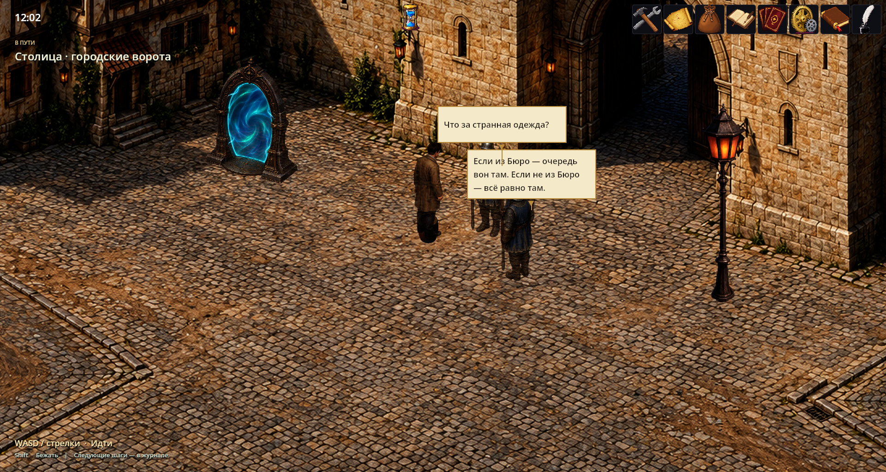
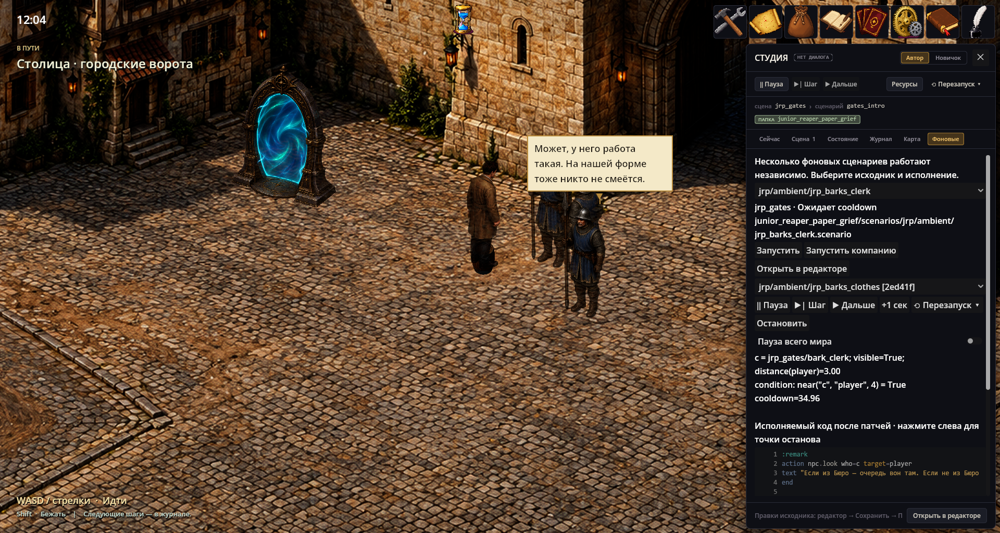

# Фоновые разговоры НПС

`npc_barks_base` запускает несколько сценариев одновременно на RPG-карте. Реплики появляются над персонажами, а игрок продолжает идти. Мод использует общий язык и `DialogRuntime` из `dialog_base`; у каждого исполнения свои переменные, ожидания и отладчик. Основное диалоговое окно не занимается. Это прототип с ограниченным набором команд.



## Добавить разговор

Включите `npc_barks_base` в игру. Персонажи ниже должны быть расставлены на карте. Файл `scenarios/ambient/greeting.scenario`:

```scenario
scene: my_meadow
channel: ambient
actor.guard: my_meadow/guard
anchor: guard
condition: near("guard", "player", 4)
cooldown: 30
once: false
priority: 0
---
:greet
action npc.look who=guard target=player
text "Добрый вечер." who=guard duration=3 cue=guard_greeting
end
```

Идентификатор — путь относительно `scenarios/` без расширения: `ambient/greeting`. `key=` переводит реплику обычным способом. `channel: ambient` исключает сценарий из основной очереди диалогов; без `channel` действует обычный канал `dialog`.

- `scene` — обязательный ID карты.
- `actor.<роль>` — участник, полный ID расстановки начинается с `<scene>/`. Участники должны существовать, быть видимыми и не двигаться.
- `anchor` — одна из объявленных ролей, по умолчанию первая. Задаёт говорящего по умолчанию и область `self.`.
- `condition` — условие запуска; `priority` — меньший номер запускается раньше, при равенстве порядок по ID.
- `cooldown` — конечное неотрицательное число секунд после завершения, по умолчанию 30.
- `once: true` — после успешного завершения больше не запускать; история сохраняется.

Участники резервируются вместе: один НПС не участвует в двух разговорах сразу. Разговоры с разными участниками независимы, до 32 исполнений. Маршрут участника удерживается до завершения или прерывания. E/F на участнике прерывает его фоновый разговор и освобождает его для диалога с игроком.

## Команды и условия

Поддержаны `text`, `ptext`, `when`, `goto`, `delay`, `flag`, `set`, `cset`, `end` и только `action npc.look`. Выборы, смена сцен, битвы, выдача предметов и произвольные действия здесь отклоняются при проверке. `wait=false` у реплики запрещён.

`who=` — роль говорящего, `duration=` — положительное конечное время чтения в секундах. Без него время оценивается по длине текста, от 2 до 8 секунд. `cue=` обозначает событие реплики. `npc.look who=<роль> target=<роль|player|source>` удерживает взгляд участника на цели.

| Условие | Значение в прототипе |
|---|---|
| `near("guard", "player", 4)` | Евклидово расстояние в клетках; целый радиус 0–1000 |
| `visible("guard")` | Участник существует и логически видим; это не проверка видимости через стены или камеру |
| `moving("player")` | Участник сейчас движется |
| `can_hear("guard", "source")` | Расстояние не больше 8 клеток, без акустики стен и дверей |

`player` и `source` зарезервированы, объявлять их через `actor.*` нельзя. `source` — персонаж, чья реплика вызвала реакцию. Обычные флаги и операторы общего языка условий тоже работают.

```scenario
when "!near(\"guard\", \"player\", 5)" wait=true timeout=8 else=still_here -> :left
:still_here
text "Всё ещё здесь?" who=guard
end
:left
text "Ушёл куда-то…" who=guard
end
```

`wait=true` проверяет живое условие до успеха или таймаута; `timeout` должен быть положительным конечным числом. При успехе используется стрелка, при истечении — `else`. Без цели исполнение продолжается со следующей строки.

## Реагировать на чужую реплику

Другой сценарий может указать `on: speech.finished`, `cue: guard_greeting`, необязательный `source_actor: my_meadow/guard` и своё `actor.vendor: my_meadow/vendor`. Условие `can_hear("vendor", "source")` проверит расстояние до источника. `speech.started` тоже поддержан; `on` требует `cue`.

Реакции ставятся на следующий шаг симуляции. События другой сессии, дубликаты, события старше двух секунд симуляции и цепочки глубже восьми отбрасываются. Прерывание публикует `speech.interrupted`, а не ложное завершение; подписка через `on` на эту фазу не поддержана.

## Патч по метке

В зависимом моде создайте `patches/scenarios/greeting.scenario`:

```scenario
patch_of: ambient/greeting
replace: greet
---
text "Рынок скоро закроется." who=guard duration=3
end
```

`replace` сохраняет метку и заменяет тело до следующей; вводить новые метки в нём нельзя. `remove: greet` удаляет блок. `append_blocks: true` добавляет явно размеченные блоки, если исходное тело заканчивается `end`. Это механизм фонового хоста, адресующий устойчивые метки, а не номера строк. Дубли меток и отсутствующие цели переходов отклоняются.

## Редактировать и отлаживать в игре

Откройте обычный **Редактор сценариев**. Он редактирует `channel: ambient` в тех же вкладках, проверяет буфер вместе с патчами и при сохранении обновляет каталог. **F5** запускает текущий буфер; после остановки или завершения открывается тот же редактор. Уже работающие исполнения сохраняют свою скомпилированную программу до перезапуска.

**Студия → Фоновые** отдельно показывает каталог исходников и исполнения: роли, причины допуска, текущую строку, ожидание, переменные и журнал. Пауза, шаг, продолжение, **+1 сек**, остановка и перезапуск действуют на выбранное исполнение. Точки останова относятся к ID исходника, транспорт — к ID исполнения. Можно открыть исходник в редакторе и запустить компанию соседних сценариев.



Обычные меню и блокирующие инструменты останавливают симуляцию и таймеры чтения. Фоновые инструменты используют режим наблюдения; в студии есть отдельная пауза всего мира. Выход из сцены, замена мира и применённая перезагрузка модов прерывают исполнения и освобождают роли.

## Сохранение и ограничения

Слот `npc_barks_base`, блок `History`, хранит завершённые ID и оставшиеся задержки. Пузырьки, указатели исполнения и очередь событий не сохраняются и не воспроизводятся при загрузке. Активному разговору при сохранении назначается короткая задержка. Прерывание не засчитывается как завершение. `flag self.done 1` сохраняется как обычный флаг области опорного персонажа.

Пример потребителя — разговоры у ворот и на рынке `junior_reaper_paper_grief`. Проверки `npc_barks` и `npc_barks_tools` упражняют параллельность, реакции и инструменты. Исходники — `src/`; общий контракт хоста — `dialog_base` → `IScenarioExecutionHost` и `IBackgroundScenarioTools`.
