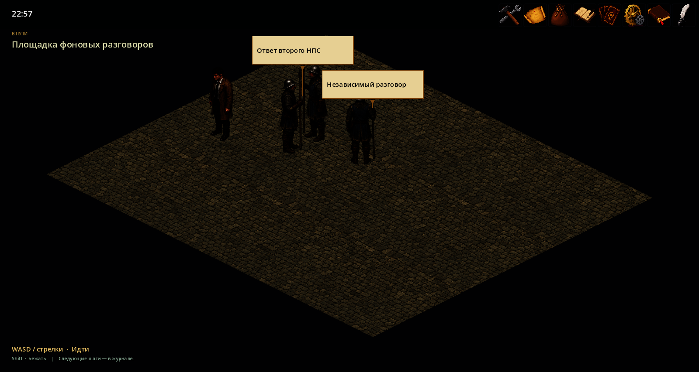
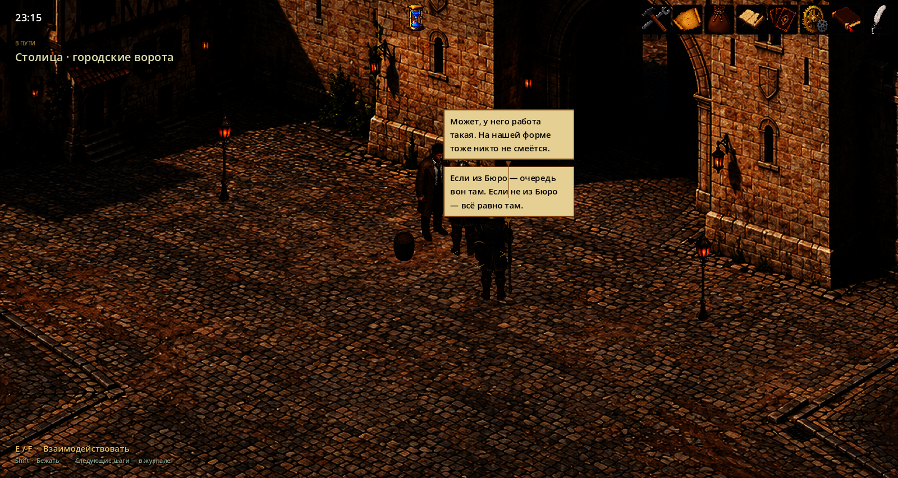
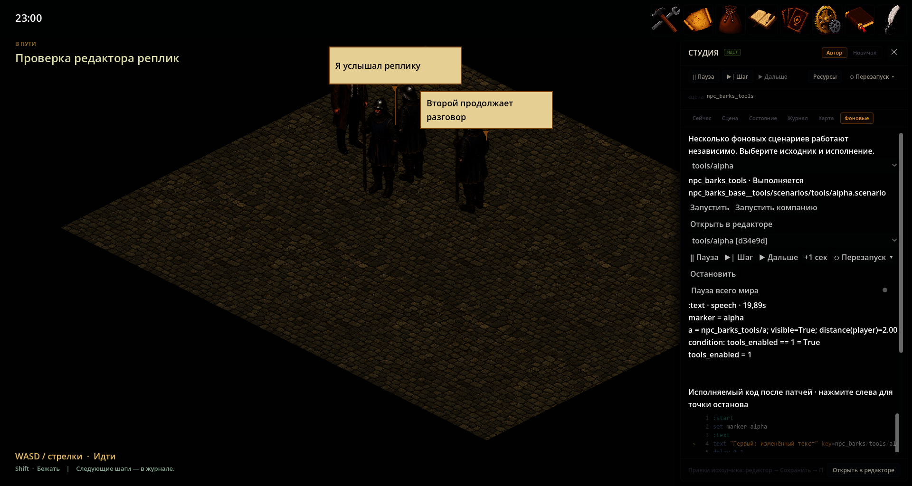
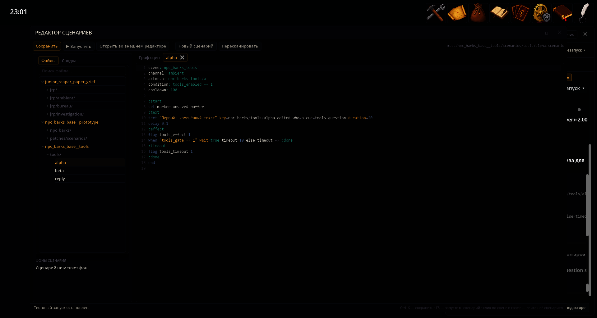

# Фоновые разговоры НПС

`npc_barks_base` исполняет несколько `.scenario` одновременно, показывает реплики над НПС и запускает ответные сценарии по смысловым событиям речи. Используется общий `DialogRuntime`; новая JSON-структура для разговоров не нужна. Версия 0.1 — опытный образец.



На снимке работают три сценария: первый НПС ждёт реакции игрока, второй отвечает на его завершённую реплику, третий ведёт независимый разговор. Рамки разведены на экране; игрок продолжает двигаться.

## Посмотреть в JRP

Мод подключён зависимостью `junior_reaper_paper_grief`. У ворот компания дополнена двумя отдельными НПС. Подойдите к коллегам: один замечает одежду Стаса, другой отвечает, третий произносит самостоятельную реплику. Отойдите от первого НПС дальше шести клеток — он прокомментирует уход. Если остаться рядом, разговор пойдёт по другой ветке. Повторный запуск ограничен cooldown.

Фразы находятся в `mods/junior_reaper_paper_grief/scenarios/jrp/ambient/`. Демонстрация использует близость и сюжетный флаг завершения дела; отдельная модель одежды или экипировки не добавлялась.

Запуск из корня проекта на хосте:

```text
godot --path . -- --game=junior_reaper_paper_grief --new --scene=jrp_gates
```

Сначала завершите обычный вступительный диалог карты: пока открыт обычный диалог или панель, фоновые разговоры приостановлены.



## Редактировать и отлаживать в игре

Для запуска с обоими инструментами добавьте к аргументам игры `--with-mods=scenario_studio,scenario_editor` (если они ещё не включены в выбранный набор инструментов). Затем откройте **Студия → Фоновые**. В верхнем списке выберите сценарий, например `jrp/ambient/jrp_barks_clothes`, а во втором — конкретное исполнение с коротким ID. Несколько НПС могут выполнять один или разные сценарии независимо.



Кнопка **Открыть в редакторе** открывает исходный `.scenario` в существующем редакторе сценариев. **Сохранить / Ctrl+S** проверяет фоновый сценарий вместе с патчами до записи. При ошибке файл не меняется, редактор показывает причину. При успешном сохранении каталог применяется без перезапуска игры. Уже работающие исполнения сохраняют свою прежнюю программу; **Перезапуск** выбранного исполнения берёт сохранённую версию.

**F5 / Запустить** использует текущий буфер редактора, включая несохранённые изменения. Предпросмотр идёт на карте и не занимает обычный DialogBox. Сохранение буфера не происходит автоматически. Кнопка остановки над игрой или завершение предпросмотра возвращает в тот же редактор с тем же буфером.



Для независимой отладки выберите исполнение и используйте:

- **Пауза / Дальше** — остановить и продолжить только выбранный разговор, включая его текущую выдержку.
- **Шаг** — выполнить одну команду DSL. Компиляция `action` в несколько внутренних действий не превращает её в несколько авторских шагов.
- **+1 сек** — продвинуть часы выбранного исполнения; удобно для ожиданий и тайм-аутов. Ложное условие не превращается в истинное от нажатия «Шаг».
- **Перезапуск** — начать выбранный сценарий заново с актуальной сохранённой программой. Состояние мира и уже совершённые сюжетные эффекты не откатываются.
- **Остановить** — освободить участников выбранного исполнения. Этот сценарий не запускается автоматически снова, пока автор явно его не запустит или не сменится карта.
- **Пауза всего мира** — остановить симуляцию и все фоновые часы, оставив инструменты доступными.

Слева от строк исполняемого кода можно поставить точку останова. Здесь показано тело **после патчей**, а не исходник до их применения. Стрелка указывает текущую строку. После изменения структуры программы проверьте позиции точек останова в новой версии.

Инспектор показывает роли и размещения, расстояния до игрока, значения проверяемых условий и флагов, локальные переменные, текущую метку, ожидание и оставшееся время. Каталог объясняет отсутствие запуска: другая карта, скрытый или занятый участник, cooldown, ложное условие либо ожидание cue. Журнал содержит последние события речи, изменения результатов проверок и действия отладчика.

**Запустить** принудительно создаёт предпросмотр выбранного сценария, обходя его условие запуска и cooldown; наличие участников по-прежнему требуется. **Запустить компанию** дополнительно допускает остальные подходящие автоматические сценарии карты, а ответы запускаются обычными cue-событиями. Для предпросмотра ответного сценария без реального события нужен `source_actor` в заголовке.

Открытые студия и редактор не замораживают фоновые разговоры. Ввод в текстовом поле принадлежит редактору и не двигает игрока. Обычный диалог, инвентарь и другие игровые панели сохраняют своё блокирующее поведение. При закрытии последнего окна наблюдения отладочные удержания и пауза мира освобождаются.

Файлы `patches/scenarios/` также доступны в дереве существующего редактора. Их сохраняют и применяют к целевому сценарию; F5 следует запускать на самом сценарии. Обычные сценарии без `channel: ambient` по-прежнему используют прежний режим F5.

## Написать разговор

```text
scene: jrp_gates
channel: ambient
actor.a: jrp_gates/colleagues
anchor: a
condition: near("a", "player", 4) && jrp_case_complete != 1
cooldown: 30
---
:hello
action npc.look who=a target=player
text "Что за странная одежда?" key=jrp/barks/company/clothes who=a cue=jrp_strange_clothes duration=3
when "!near('a', 'player', 6)" wait=true timeout=8 else=stayed -> :left
:stayed
text "И стоит. Наверное, по служебному вопросу." key=jrp/barks/company/stayed who=a duration=3
goto -> :done
:left
text "Ушёл куда-то…" key=jrp/barks/company/left who=a duration=3
:done
end
```

`actor.<роль>` указывает конкретное размещение на карте. `anchor` определяет говорящего по умолчанию и область флагов `self.`; если он не указан, используется первая роль. Все участники должны быть видимыми и стоять на месте при запуске. Они резервируются атомарно: два сценария одновременно одним НПС не управляют.

`text who=` выбирает говорящего, `duration=` задаёт выдержку в игровых секундах. Без duration время рассчитывается по длине перевода. Несколько ролей в одном файле позволяют вести последовательный разговор: следующий `text` может принадлежать другому НПС.

Обычный `when` по-прежнему проверяет условие один раз. `wait=true timeout=` ждёт истинности условия либо переходит в `else` после тайм-аута. В примере проверяется текущее удаление игрока; короткий уход с возвращением во время первой фразы не запоминается как отдельное событие.

Общие условия флагов, квестов и загруженных механик работают вместе с `near`, `visible`, `moving`, `can_hear`. Радиусы в выражениях — целые числа, координаты — логические клетки. `can_hear` в прототипе означает дистанцию до восьми клеток и наличие видимых участников; стены и двери акустически не моделируются.

`action npc.look who=a target=player` удерживает внимание участника до завершения сценария. Целью может быть другая роль. Кроме этого, стоящие неподвижные НПС категории `npc` периодически посматривают на близкого игрока. Новые команды маршрута участников удерживаются, уже начатые шаги не обрываются.

Заголовки `cooldown` и `once: true` задают повторяемость. Приоритет соответствует обычным сценариям: меньшее число раньше. `self.x` всегда относится к якорному размещению, независимо от текущего говорящего.

## Ответить на чужую реплику

```text
scene: jrp_gates
channel: ambient
actor.b: jrp_gates/bark_responder
anchor: b
on: speech.finished
cue: jrp_strange_clothes
source_actor: jrp_gates/colleagues
condition: can_hear("b", "source")
cooldown: 15
---
:reply
action npc.look who=b target=source
text "Может, у него работа такая." key=jrp/barks/company/reply who=b duration=4
end
```

`cue` — смысловой ID, не текст реплики и не locale-ключ. `source` связывается с говорящим конкретного события. `source_actor` необязателен; без него допускается любой подходящий источник. Ответчик владеет своей ролью `b`, а не чужим источником.

Поддерживаются запуск по `speech.started` и `speech.finished`. Прерванная речь не создаёт нормальное завершение. Каждое произнесение имеет отдельный ID; дубликат события не запускает вторую реакцию. Доставка отложена, глубина цепочки ограничена восемью событиями. Неактуальные события другой сессии или карты отбрасываются.

Если отвечающий занят, событие в этой версии отбрасывается. Общая очередь событий ограничена, срок актуальности — две игровые секунды. Для строго согласованной компании удобнее один сценарий с несколькими `who`.

## Изменить одну ветку модом

Объявите зависимость от владельца исходника и создайте файл `patches/scenarios/<уникальное_имя>.scenario`:

```text
patch_of: jrp/ambient/jrp_barks_clothes
replace: left
---
text "Ладно, ещё увидимся." key=my_mod/barks/left who=a duration=3
goto -> :done
```

`patch_of` — путь относительно `scenarios/` без расширения. Заменяется тело между `:left` и следующей меткой; сама метка остаётся. Соседние блоки не копируются.

Доступны `replace`, `remove`, `append_blocks: true`. Добавляемые блоки должны иметь явные уникальные метки, а старый файл завершаться `end`, чтобы вставка не изменила неявное продолжение. После композиции проверяются переходы. Патчи применяются по порядку зависимостей, внутри мода по имени файла. В прототипе эта композиция обслуживает только фоновые сценарии; общий загрузчик обычных диалогов не изменён.

## Переводы и сохранения

Русский литерал и `key=` сохраняют обычный формат. Записи находятся непосредственно в `locale/scenarios_ru.properties` или любом другом плоском `*_<lang>.properties`; JRP использует `barks_ru.properties` и `barks_en.properties`. Текущая рамка переводится при смене языка без повторного выполнения команд.

В слоте мода сохраняются завершения и оставшиеся cooldown. Таймеры останавливаются вместе с модальными окнами. Активная фраза после загрузки не продолжается посреди строки; события речи не переигрываются. Сюжетные `flag` сохраняются существующей системой. Точный журнал услышанных знаний и политики сюжетных эпох JRP пока не реализованы.

## Проверить прототип

```text
godot --path . --headless -- --game=junior_reaper_paper_grief --new --run-tests --mod=npc_barks_base
godot --path . -- --game=junior_reaper_paper_grief --new --itest=npc_barks --shots=<каталог>
```

Вторая команда активирует изолированную suite: независимые исполнения, ответ на cue, дублированная доставка события, реальная ходьба, поворот, уход, тайм-аут, пауза, смена языка, адресный патч, E/F и смена карты. Затем проверяется компания на настоящей карте JRP. Запускать длительные проверки следует через файловый job-мост workspace.

## Границы версии

Поддерживаются `text`, `ptext`, `when`, `goto`, `delay`, `flag`, `set`, `cset`, `end`, `action npc.look`. Остальные команды отклоняются перед запуском; опечатки не пропускаются молча. `when wait=true` требует фонового хоста, обычный when и обычные диалоги сохраняют поведение.

На карте допускается до 32 активных сценариев, кандидаты индексируются по карте и типу события. Это защитный предел прототипа, а не результат нагрузочного измерения. Рамки разводятся простым алгоритмом, переполнение экрана скрывает рамку. Нет симуляции выгруженных карт, акустики стен, возобновления посреди фразы, автоматического подбора участников или автоматического отката сюжетных эффектов при перезапуске фонового исполнения.
